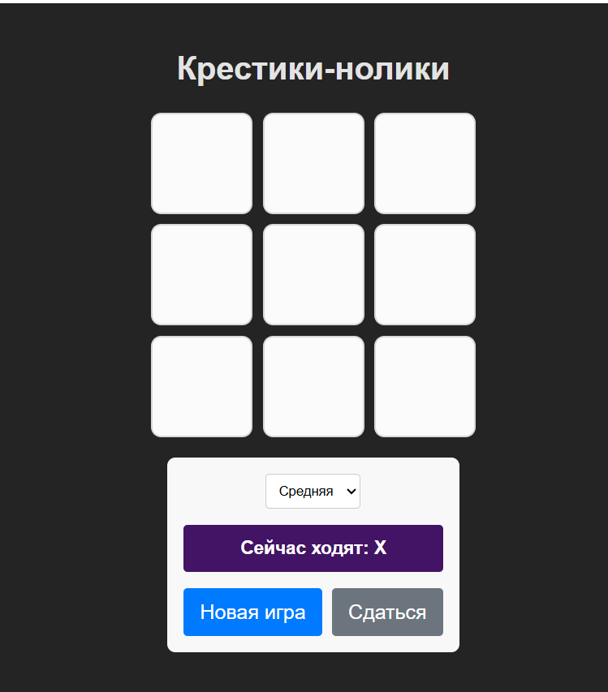
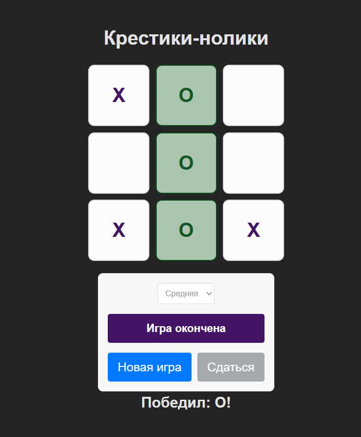
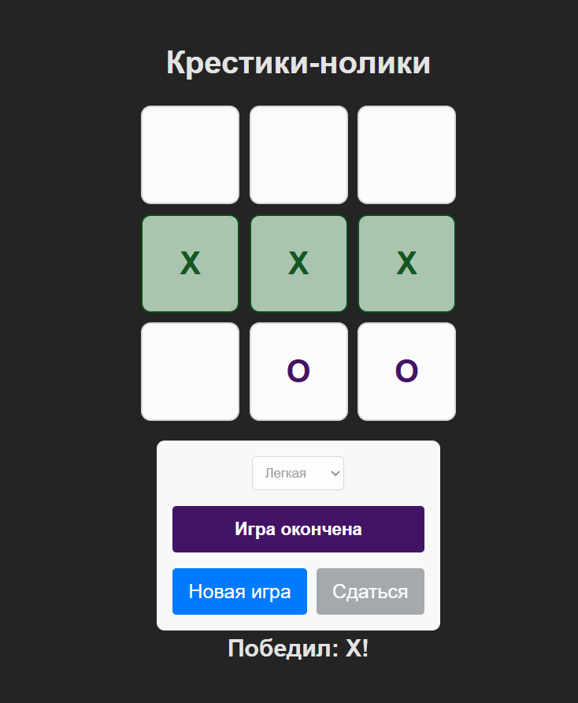

# Лабораторная работа №4: React и TypeScript

## Описание проекта
Веб-приложение «Крестики-нолики» с компьютерным противником. 
Проект разделен на две части:
1. **`ui-library`** — библиотека UI-компонентов (`GameBoard`, `GameControls`, `Button`).
2. **`frontend`** — приложение, которое использует эти компоненты и содержит игровую логику.

## Функционал
- Игра против бота (3 уровня сложности: легкий, средний, сложный с алгоритмом Минимакс).
- Подсветка выигрышной линии.
- Выбор сложности, кнопки «Новая игра» и «Сдаться».

## Примеры работы приложения

**Главное меню (начало игры):**

**Победа бота:**

**Поражение бота (победа игрока):**

## Технологии
- React, TypeScript, Vite.
- Jest, React Testing Library (покрытие тестами компонентов — 100%).
- ESLint (код проходит проверку без ошибок).